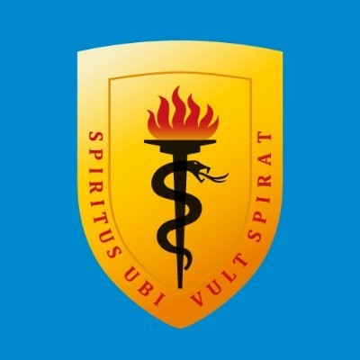

  <h2>UNIVERSIDAD PERUANA CAYETANO HEREDIA</h2>
  <h3>FACULTAD DE CIENCIAS E INGENIERÍA</h3>
   
  
    
  <h1>Entregable 3 - Avance</h1>
   

  <h3>Integrantes</h3>
  

    Huarcaya Chipana, Héctor 
    Hidalgo Castillo, Carlos Antonio 
    Fernandez Gamonal, Fernando Matias 
    Marquiño Nieva, Jordan Adriano 
    Tadeo Arquinigo, Leslye Tatiana
  

  <h3>Docentes</h3>
  

    Contreras Paucca, Jhomer Rodrigo 
    Da Silva, Jose Luiz 
    Esquiagola Aranda, John Edward
  

   
  

    <strong>Lima - Perú</strong> 
    Noviembre de 2026
  

     

   

  <h1>PROTOTIPO</h1>
nuestros prototipos se realizaron en base a las retroalimentaciones de los profesores, debido a que en un comienzo se asignó otro tipo de modelo que empiricamente era complicado adaptarlo 

 

  
    
  

 
Presentamos en link de One shape
https://cad.onshape.com/documents/adc0ac7b5d26842fc39e2610/w/8201609f4aa3a00f7535a162/e/51898e513cd294146749d164

Presentamos en link de EasyEDA
https://u.easyeda.com/join?type=project&key=a0619f1729f0c121cdeff452665f5185&inviter=0351cbfd9f574ec9992b3cac7d51c8f4

